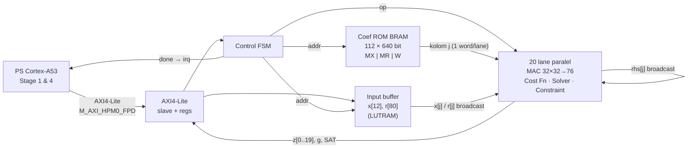

# MPC Accelerator untuk Kria KV260 (XCK26): RTL, Simulasi, Vivado, Deploy

Bagian hardware (orang kedua). Implementasi PL untuk tahap **Prediction** dan **Optimization (ADMM)** dari MPC quadcopter.
Golden model, ROM, dan test vector dibuat orang pertama di [../quadcopter_mpc/test_vectors](../quadcopter_mpc/test_vectors) (lihat `FORMAT.md` di sana).

## Status

| Tahap | Status |
|---|---|
| Lisensi XCK26 di Vivado 2022.1 | **Belum dicek**: Vivado tidak ada di laptop ini. Jalankan `vivado/check_license.tcl` (lihat §5) |
| Mikroarsitektur (Gambar 7.1) | Selesai (§2) |
| RTL Verilog + AXI4-Lite | Selesai, `hdl/` |
| Simulasi vs test vector | **4000/4000 bit-exact** (Q16.16 dan Q8.24), lihat §4 |
| Block design + bitstream | Script siap (`vivado/build.tcl`), belum dijalankan (belum ada Vivado) |
| Overlay, program PS, deploy | File siap di `deploy/`, menunggu bitstream dan board |

## 1. Isi folder

```
hdl/mpc_accel_axi.v     top: AXI4-Lite slave + register map (dipakai sebagai module reference di BD)
hdl/mpc_core.v          Control FSM, ROM koefisien (BRAM), buffer input, 20 lane
hdl/mpc_lane.v          satu lane MAC: Prediction, Cost Function, Solver, Constraint Evaluation
hdl/mpc_ops.vh          kode op lane
scripts/gen_hw_files.py ekspor golden model -> mem/<fmt>/ (ROM lebar, tv.hex, config) + deploy/sw/mpc_formats.h
mem/q16_16, mem/q8_24   file hasil generate (jangan diedit manual)
sim/tb_mpc_accel.v      testbench via AXI4-Lite, bandingkan g dan z bit-exact
sim/run_sim.sh          compile + run Icarus Verilog
vivado/check_license.tcl  cek lisensi/device XCK26
vivado/build.tcl        project + block design (PS Zynq UltraScale+ + SmartConnect) -> bitstream, .bit.bin, .xsa
deploy/overlay/         device-tree overlay + shell.json untuk xmutil
deploy/sw/              driver C++ (PS, Cortex-A53) + program uji/profiling di board
deploy/install_on_board.sh  dijalankan di KV260: pasang app xmutil, load, build program
```

## 2. Mikroarsitektur

Algoritma per siklus kontrol (Ts = 5 ms), sama persis dengan golden model:

```
g = R(MX·x, F_MX) − R(MR·r, F_MR)                         Prediction Engine
z = y = 0
ulangi N_ITER = 80 kali:
    rhs   = R(rho·(z − y), F_P) − g                       Cost Function Unit (gradien cost teraugmentasi)
    u     = R(W·rhs, F_W)                                 Numerical Solver Kernel (MAC 20×20)
    u_hat = R(alpha·u, F_P) + R((1−alpha)·z, F_P)
    z     = clamp(u_hat + y, ZMIN, ZMAX)                  Constraint Evaluation
    y     = (y + u_hat) − z
output z[0..19]; PS memakai z[0..3]
```
R(v, F) adalah pembulatan sekali di akhir: `(acc + 2^(F−1)) >>> F` lalu saturasi int32, dengan akumulator 76-bit yang exact.



Pemetaan ke blok Gambar 7.1:

| Blok Gambar 7.1 | Implementasi |
|---|---|
| AXI4-Lite Slave Interface | `mpc_accel_axi.v`, register map di §3 |
| Control FSM | `mpc_core.v`, menerbitkan 1 op/siklus ke semua lane secara lockstep |
| Prediction Engine (MAC paralel) | lane i menghitung baris i dari MX·x dan MR·r; x[j]/r[j] di-broadcast, 20 MAC paralel |
| Cost Function Unit | op `RHS`: rho·(z−y) − g per lane |
| Numerical Solver Kernel | op `MAC` atas W (20 siklus, rhs[j] di-broadcast antar lane) + `RND_U`, `OMZ`, `AU` |
| Constraint Evaluation | op `UPD`: clamp ke [ZMIN, ZMAX] + update dual y |
| BRAM | ROM koefisien 640-bit (satu kolom MX/MR/W per alamat, satu word per lane) + buffer input |

Lane memakai pipeline 4 tahap (pilih operand → multiply → register DSP → retire). Op yang membaca z, y, u, atau rhs harus diterbitkan
minimal **GAP = 3** slot setelah op yang menulisnya. Uji mutasi menunjukkan GAP = 2 menghasilkan output salah.

Jadwal per solve: 12 MAC (MX) + 80 MAC (MR) + 80 × 33 siklus ADMM (RHS, OMZ, 2 tunggu, 20 MAC, RND_U, 3 tunggu, AU, UPD, 3 tunggu).
**Latensi = 33·N_ITER + 98 = 2738 siklus = 27,38 µs @ 100 MHz = 0,55 % dari Ts**, deterministik (jitter 0 di PL).

Estimasi resource (perlu dikonfirmasi lewat `utilization_impl.rpt`):

| Resource | Estimasi | KV260 (XCK26) | % |
|---|---|---|---|
| DSP48E2 | ~80 (20 lane × 4 untuk 32×32) | 1248 | ~6 % |
| BRAM36 | ~9 (ROM 640-bit) | 144 | ~6 % |
| LUT | ~15–20 k | 117 k | ~15 % |
| FF | ~12 k | 234 k | ~5 % |

Ruang optimasi jika diperlukan: clock 200 MHz (→ 13,7 µs), 2 MAC per lane (loop W 10 siklus), atau warm start.

## 3. Register map (base 0xA000_0000, 4 KB)

| Offset | Nama | Akses | Isi |
|---|---|---|---|
| 0x000 | CTRL | W / RW | bit0 START (tulis 1, diabaikan saat busy), bit1 IRQ_EN |
| 0x004 | STATUS | R | bit0 BUSY, bit1 DONE (sticky, di-clear oleh START), bit2 SAT |
| 0x008 | N_ITER | RW | iterasi ADMM (default 80) |
| 0x00C | CYCLES | R | jumlah siklus clock solve terakhir |
| 0x010 | ID | R | 0x4D504331 ("MPC1") |
| 0x014 | CONFIG | R | [7:0] F_W, [15:8] F_MX, [23:16] F_MR, [31:24] F_P. Menandai format bitstream |
| 0x400 + 4k | IN[k] | RW | k = 0..11: x0..x11, k = 12..91: r0..r79 (raw int32, sudah di-scale). Tulisan saat busy diabaikan |
| 0x800 + 4i | Z[i] | R | z[i], i = 0..19 |
| 0x900 + 4i | G[i] | R | g[i] (debug) |

IRQ: `irq = DONE & IRQ_EN`, terhubung ke `pl_ps_irq0[0]` (GIC SPI 89).
Konversi PS (Stage 1 & 4) ada di `deploy/sw/mpc_accel.hpp::compute()`: `x_q = round(x·X_SCALE·2^F)`, `u_k = U_SCALE_k·z_k/2^F`, `F_total += 0,66708 N`.

## 4. Simulasi (verifikasi RTL)

Butuh Icarus Verilog (`pacman -S mingw-w64-ucrt-x86_64-iverilog` di MSYS2) dan Python (hanya standard library).

```bash
python scripts/gen_hw_files.py          # setiap kali golden model / ROM orang pertama berubah
sim/run_regression.sh 6                 # 4000 vector x 2 format, 6 potongan paralel per format
sim/run_sim.sh q16_16 +NVEC=50 +STRIDE=80   # cek cepat satu format
sim/run_sim.sh q16_16 +NVEC=1 +VCD      # waveform -> tb_mpc_accel.vcd (GTKWave)
```

Testbench hanya memakai AXI4-Lite (cek ID, CONFIG, readback buffer, START, IRQ, baca Z/G/STATUS/CYCLES), lalu membandingkan
g[0..19] dan z[0..19] bit-exact dengan output golden model, serta memastikan flag SAT = 0.

Hasil:

| Format | Vector | Bit-exact | Latensi |
|---|---|---|---|
| Q16.16 | 4000 | 4000/4000 | 2738 siklus |
| Q8.24 | 4000 | 4000/4000 | 2738 siklus |

Log ada di `sim/logs/`. Uji mutasi (pembulatan diganti truncation, GAP = 2) keduanya terdeteksi FAIL.

## 5. Vivado 2022.1 (perlu PC yang sudah terpasang Vivado)

> Path project **tidak boleh mengandung spasi** (`Semester 5` akan gagal). Salin folder `mpc_accel_hw/` ke misalnya `C:/work/mpc_accel_hw`.

1. **Cek lisensi/device (prasyarat):**
   `vivado -mode batch -source vivado/check_license.tcl` harus mencetak `LICENSE CHECK: PASS`.
   - `part ... not installed`: jalankan installer → *Add Design Tools or Devices* → centang *Zynq UltraScale+ MPSoC*.
   - Error lisensi (Common 17-345): buka *Vivado License Manager* → *Obtain License*. K26 seharusnya tercakup edisi no-cost
     (Vivado ML Standard), tetapi hal ini wajib dikonfirmasi lewat script, bukan diasumsikan.
2. **Build:** `vivado -mode batch -source vivado/build.tcl -tclargs q16_16`
   - membuat project untuk `xck26-sfvc784-2LV-c` dengan board part KV260 (otomatis diunduh dari board store kalau belum ada),
   - block design: `zynq_ultra_ps_e` (preset KV260, HPM0_FPD, pl_clk0 100 MHz, IRQ0) → AXI SmartConnect → `mpc_accel_axi`
     (module reference) + `proc_sys_reset`, alamat 0xA000_0000 / 4 KB,
   - synth → impl → bitstream, cek WNS, lalu `bootgen` untuk `.bit.bin`.
   - Output: `vivado/build_q16_16/out/` (`mpc_accel.bit`, `mpc_accel.bit.bin`, `mpc_accel.xsa`, laporan utilization/timing/power).
   - Coba dulu tanpa implementasi: `-tclargs q16_16 bd` lalu buka project di GUI untuk melihat block design.
3. Format yang dipakai mengikuti keputusan orang pertama (Q16.16 atau Q8.24). Keduanya memakai RTL yang sama; yang berbeda
   hanya file ROM dan parameter `FRAC_*`.

## 6. Deploy ke KV260

1. **SD card (di PC):** unduh image *Ubuntu 22.04 LTS for AMD Kria KV260* dari ubuntu.com/download/amd, tulis ke microSD
   ≥ 32 GB pakai balenaEtcher. Image ditulis ke SD card, bukan diinstal ke PC. Kalau board tidak boot, update boot firmware K26
   lewat *Image Recovery Tool* (lihat wiki Kria).
2. Colok SD, Ethernet, USB-UART (115200), power. Login `ubuntu` / `ubuntu` (wajib ganti password).
3. `sudo snap install xlnx-config --classic --channel=2.x` lalu `sudo xlnx-config.sysinit`, kemudian reboot.
   Cek `sudo xmutil listapps`.
4. Salin ke board: folder `deploy/`, `out/mpc_accel.bit.bin` (ke dalam `deploy/`), dan `mem/<fmt>/tv.hex`.
   ```bash
   scp -r deploy mpc_accel.bit.bin tv.hex ubuntu@<ip-board>:~/mpc/
   ssh ubuntu@<ip-board>
   cd ~/mpc/deploy && cp ../mpc_accel.bit.bin . && bash install_on_board.sh
   sudo sw/mpc_hw_test ../tv.hex            # harus 4000/4000 bit-exact
   ```
   `install_on_board.sh` meng-compile overlay (`dtc`), memasang ke `/lib/firmware/xilinx/mpc_accel/`, menjalankan
   `xmutil unloadapp` + `xmutil loadapp mpc_accel`, lalu build program PS.
5. `mpc_hw_test` mencetak avg/min/P99/max/jitter dan rasio terhadap Ts untuk latensi PL (register CYCLES) dan end-to-end PS
   (tulis AXI + solve + baca), lalu menyimpan `hw_profiling.csv` per vector. Data ini untuk BAB VII.
   Untuk perbandingan PS-only, compile `../quadcopter_mpc/src/main_profiling.cpp` di board yang sama (Cortex-A53).

## 7. Koordinasi dengan orang pertama

- Kalau ROM/format/N_ITER berubah: orang pertama menjalankan ulang `main_golden_model.exe`, kemudian di sini dijalankan
  `python scripts/gen_hw_files.py` dan `sim/run_sim.sh`. RTL tidak perlu diubah selama dimensi (NX = 12, NP = 20, NU_TOTAL = 20) tetap.
- Bobot Q/R ada di ROM (inisialisasi BRAM), jadi mengubah bobot berarti generate ulang bitstream.
- Istilah di BAB VII: Zynq UltraScale+ MPSoC, Cortex-A53, M_AXI_HPM0_FPD, DSP48E2 (bukan Zynq-7000 / Cortex-A9 / M_AXI_GP0 / DSP48E1).
